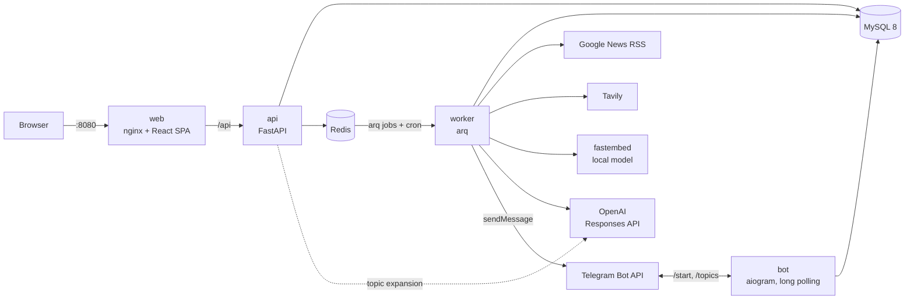

# NewsDigest

AI-дайджест новин за вашими темами з доставкою в Telegram.

Ви описуєте тему звичайними словами («Криптовалюти: ціни BTC/ETH, регулювання, великі злами бірж»), обираєте мову і частоту. За розкладом сервіс:

1. збирає свіжі новини з Google News RSS і Tavily за пошуковими запитами, які LLM згенерувала з опису;
2. прибирає дублікати URL і відкидає старі статті;
3. рахує embeddings локально (fastembed, мультимовна модель) і відфільтровує нерелевантне;
4. групує статті про одну подію в один пункт;
5. пише короткий дайджест через LLM (тільки за текстом статей, кожен пункт з посиланнями);
6. надсилає дайджест у Telegram. Якщо нових релевантних новин немає, нічого не надсилає.

На сайті видно історію дайджестів, можна редагувати запити, ставити теми на паузу і запускати розсилку вручну.

## Швидкий старт

```bash
cp .env.example .env        # можна нічого не заповнювати: усе запуститься у fake-режимі
docker compose up --build
```

Відкрийте http://localhost:8080, зареєструйтесь, створіть тему і натисніть **«Надіслати зараз»**. Через кілька секунд дайджест з'явиться в історії.

Перший запуск воркера завантажує модель embeddings (~220 МБ) у volume `model_cache`. Наступні старти беруть її з кешу.

Порт змінюється змінною `WEB_PORT` у `.env`.

## Ключі і `.env`

Усі ключі необов'язкові. Якщо ключа немає, відповідний провайдер автоматично працює як заглушка, а в логах з'являється попередження:

| Змінна | Без неї | Як отримати |
|---|---|---|
| `OPENAI_API_KEY` | `FAKE_LLM`: запити = фрази з опису, дайджест = заголовок + перше речення статті | https://platform.openai.com/api-keys → *Create new secret key* |
| `TAVILY_API_KEY` | `FAKE_TAVILY`: детерміновані демо-статті `[demo] ...` (Google News працює і без ключа) | https://app.tavily.com → API Keys (є безкоштовний ліміт) |
| `TELEGRAM_BOT_TOKEN` | `FAKE_TELEGRAM`: дайджести зберігаються лише в історії на сайті, бот простоює | Telegram → [@BotFather](https://t.me/BotFather) → `/newbot` → токен виду `123456:ABC...` |
| `TELEGRAM_BOT_USERNAME` | — | Ім'я бота без `@` (бот також публікує своє справжнє ім'я при старті) |
| `JWT_SECRET` | небезпечне значення за замовчуванням (лише для локальної розробки) | `openssl rand -hex 32` |

Інші параметри (моделі, пороги, ліміти) описані в [`.env.example`](.env.example). Найважливіші:

- `LLM_MODEL_FAST=gpt-6-luna` — розширення теми в запити; `LLM_MODEL_DIGEST=gpt-6.1-sol` — фінальний дайджест.
- `RELEVANCE_THRESHOLD=0.30` і `CLUSTER_THRESHOLD=0.80`: пороги підібрані на тестових даних, див. [DECISIONS.md](DECISIONS.md#relevance-and-clustering-calibration).
- `MAX_TOPICS_PER_USER=10`, `MAX_EVENTS_PER_DIGEST=10`.
- `ENVIRONMENT=production` вмикає `Secure`-cookie (потрібен HTTPS) і вимагає `JWT_SECRET` довжиною від 32 символів.

### Налаштування Telegram-бота

1. У [@BotFather](https://t.me/BotFather): `/newbot`, задайте ім'я і username, скопіюйте токен.
2. Впишіть `TELEGRAM_BOT_TOKEN` і `TELEGRAM_BOT_USERNAME` у `.env`, перезапустіть `docker compose up -d`.
3. (Необов'язково) у BotFather `/setcommands`:
   ```
   topics - Мої теми
   pause - Поставити тему на паузу
   resume - Відновити тему
   ```
4. На сайті натисніть **«Підключити Telegram»**: відкриється бот із одноразовим токеном (діє 15 хв). Натисніть **Start**, і сторінка сама побачить прив'язку (polling кожні 3 с).

Якщо користувач заблокує бота, наступна розсилка відв'яже чат, а сайт покаже попередження.

## Команди

```bash
docker compose up --build          # усе разом
docker compose logs -f worker      # пайплайн: зібрано / оцінено / надіслано
docker compose down                # зупинити (дані лишаються у volumes)
docker compose down -v             # зупинити і видалити всі дані
```

### Тести

```bash
# Backend (SQLite + fakeredis, без мережі й Docker)
cd backend
uv sync
uv run ruff check . && uv run ruff format --check .
uv run pytest

# Frontend
cd frontend
npm ci
npm run lint && npm run format:check && npm run typecheck
npm test
```

### Smoke-тест (E2E)

```bash
scripts/smoke_test.sh            # ~40 с з нуля (плюс збірка образів)
KEEP=1 scripts/smoke_test.sh     # залишити стек запущеним на http://localhost:18080
```

Скрипт піднімає окремий compose-проєкт `nd-smoke` на порту 18080 з примусовим fake-режимом (ваш `.env` і дані не зачіпаються). Він реєструє користувача, перевіряє неправильний пароль, створює тему, редагує запити, ставить на паузу, натискає «Надіслати зараз», чекає дайджест і перевіряє, що інший користувач цю тему не бачить. Потрібен доступ до мережі (Docker-образи, модель embeddings, Google News).

## Архітектура



```
process_topic(topic, run_key)
  ├─ collect: Google News (query × when:1h/6h/1d/7d) + Tavily (≤ 1 раз/год)
  ├─ freshness filter + URL normalization (utm_*, fbclid, …) → sha256 dedup
  ├─ articles: INSERT IGNORE (спільні для всіх тем), embedding рахується 1 раз
  ├─ relevance = max cos(article, [опис, запити]) ≥ threshold
  ├─ exclude already sent (той самий URL або та сама подія за 3 дні)
  ├─ complete-linkage clustering (≥ 0.80) → top-N подій
  ├─ LLM: {event_id, title, summary}; посилання підставляє система
  ├─ digest row (unique run_key) → commit → Telegram (HTML, ≤ 4096/повідомлення)
  └─ mark sent, last_run_at, next_run_at (timezone користувача, DST)
```

| Сервіс | Що робить |
|---|---|
| `web` | nginx: статичний React-білд, проксі `/api` → `api:8000` |
| `api` | FastAPI: auth (JWT cookie + CSRF), теми, історія, прив'язка Telegram; при старті запускає `alembic upgrade head` |
| `worker` | arq: cron-тік кожні 5 хв і job-и `process_topic` (ідемпотентні через `_job_id`) |
| `bot` | aiogram 3: `/start <token>`, `/topics`, `/pause`, `/resume` з інлайн-кнопками |
| `mysql`, `redis` | дані, черга, rate limit, локи |

Структура репозиторію:

```
backend/app/
  api/          # FastAPI роутери, схеми, CSRF
  services/     # pipeline, llm, embeddings, relevance, collectors/, telegram, schedule
  prompts/      # промпти LLM (окремі файли)
  worker/       # arq WorkerSettings
  bot/          # aiogram
backend/tests/  # pytest + записані фікстури Google News / Tavily
frontend/src/   # React + TanStack Query; усі рядки UI в i18n/uk.ts
scripts/        # smoke_test.sh
```

## Відомі обмеження MVP

- **Посилання Google News** ведуть на `news.google.com/rss/articles/...` (редирект на першоджерело). Текст статті — лише заголовок і джерело з RSS, тому резюме коротші, ніж для Tavily.
- **Назви моделей `gpt-6-luna` / `gpt-6.1-sol`** не перевірені на живому API (ключа не було). Якщо API поверне 404, змініть `LLM_MODEL_*` у `.env`. Помилка LLM під час дайджесту не зриває розсилку: використовується екстрактивний fallback, а помилка видна в історії.
- **Embeddings на CPU** у воркері: близько 100 статей за секунду. Для сотень активних тем знадобиться окремий embedding-сервіс або батчинг між темами.
- **Кластеризація** на коротких заголовках інколи об'єднує різні події з однаковими сутностями (наприклад, «Arsenal beat Chelsea» / «Chelsea beat Arsenal»).
- **Ручні запити** перезаписуються, якщо змінити опис або мову теми (запити генеруються заново).
- **Немає** скидання пароля, підтвердження email і видалення акаунта.
- **Rate limit** стоїть лише на login/register.

## Ідеї для наступних версій

- Email-доставка (і вибір каналу для кожної теми).
- Власні джерела: довільні RSS-стрічки, Telegram-канали, сайти.
- Оцінки 👍/👎 під кожним пунктом дайджесту → персональний поріг і перезважування запитів.
- Біллінг і тарифи (кількість тем, частота, моделі).
- Повний текст статей (readability) для якісніших резюме; розкодування посилань Google News.
- Векторний індекс (pgvector / Qdrant) замість BLOB для пошуку схожих подій.
- Англійська локалізація інтерфейсу (рядки вже винесені в `frontend/src/i18n/uk.ts`).
